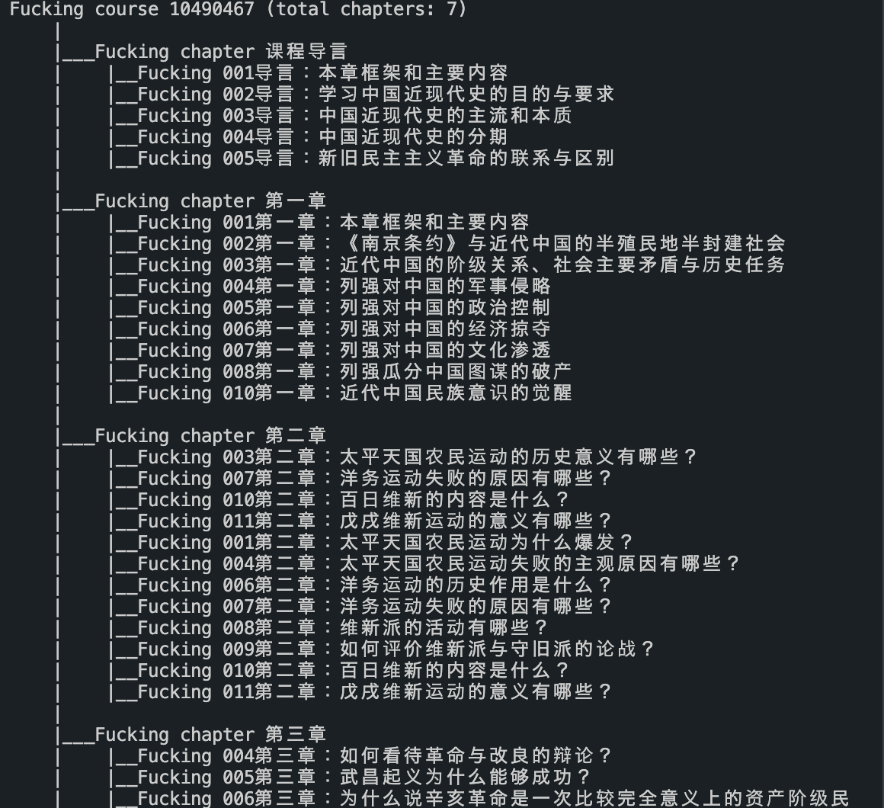
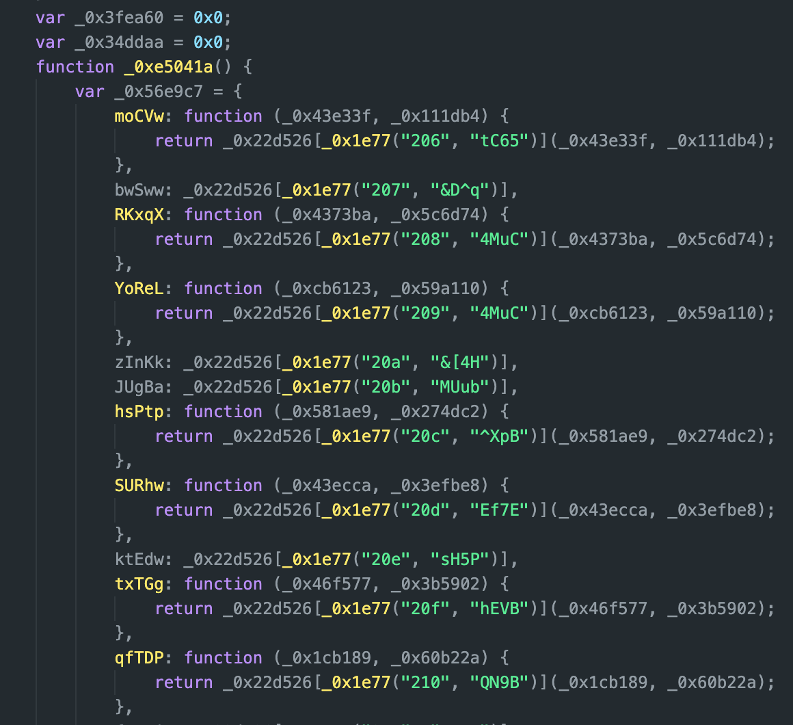
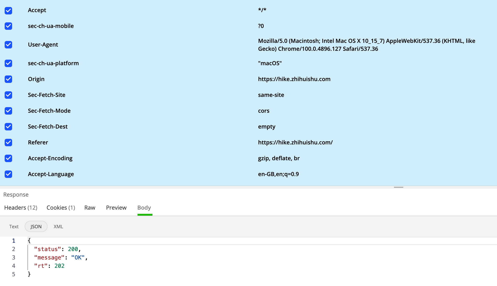
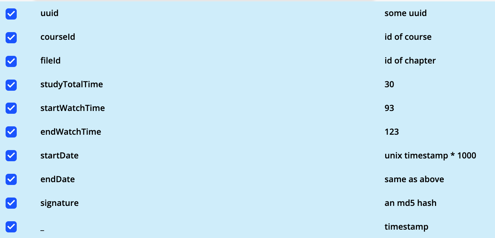
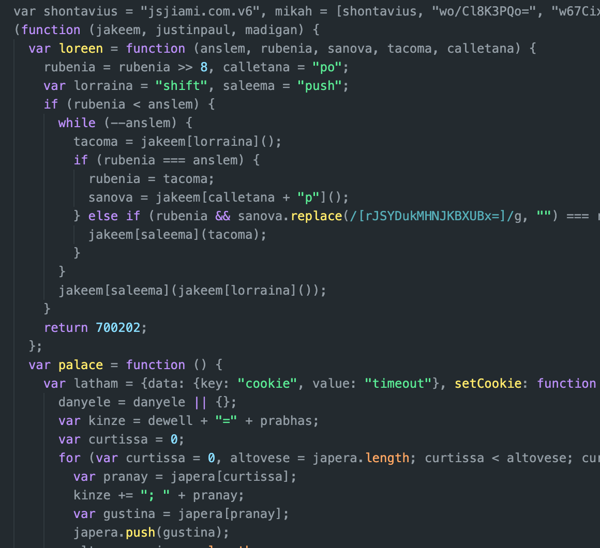
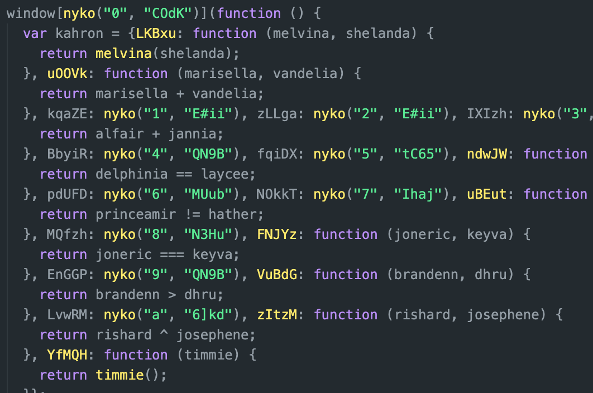
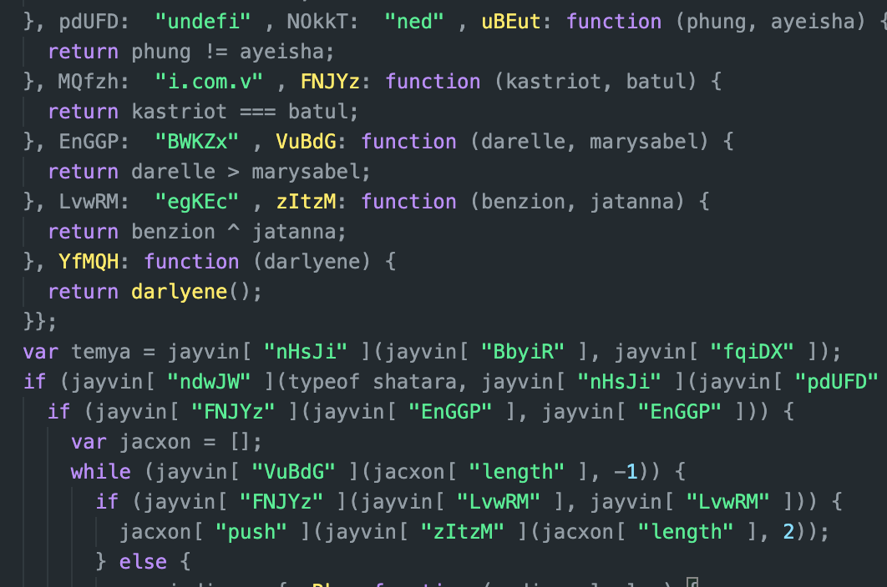
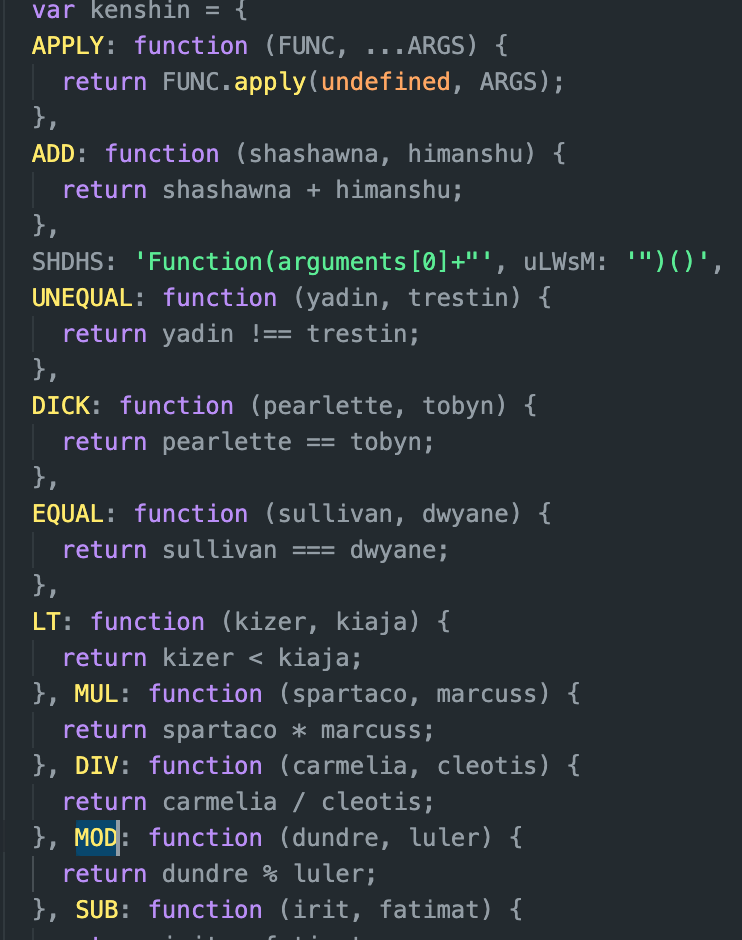
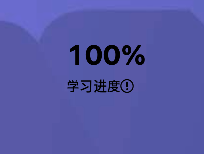

# ZHS Fucker 食用指北

> **当前版本 `2.6.3`**（`meta.json`）· 配置 schema `1.5.0`（`main.py` 中的 `DEFAULT_CONFIG`）
>
> 本指北已按 2.6.3 校对。1.x 时代的命令行用法仍然有效，但**图形界面、AI 答题、共享课平时测试**都是新增主力入口，见下文对应小节。

## NEWS

我总觉得有一天这个脚本会被 `404` ，没想到以这种形式实现了，感谢各位对鸽鸽的支持。


---

在 TG 上出现了倒卖开源代码的家伙, 其谎称有我的授权. [详见此处](https://github.com/VermiIIi0n/fuckZHS/discussions/19#discussioncomment-4168410).

本脚本是为人节约生命的, 不是增加负担的, 况且屎山代码我也不好意思卖, 倒卖就算了别说是我授权的, 丢不起这个脸

愿意支持的朋友点个 ☆ 就好, 叔叔我承诺本~~屎山~~脚本可能会下架, 但永不会变质.

---

## WTF?

这是一个 _Python3_ 的自动脚本, 用于自动刷智慧树课堂课程, 为您节约有限的生命.

### Features

- 支持校内学分课(hike)与知到共享学分课
- 自动回答视频弹题
- 设定时限
- 射后不管, 无需交互
- **图形界面**: `gui.py` 提供桌面控制器, 勾选课程、看进度、查看结果, 不必敲命令
- **AI 答题**: 支持 AI 课知识点测验, 兼容 OpenAI 接口, 覆盖单选/多选/判断/客观填空
- **共享课平时测试**: 独立入口, 批量处理普通共享课单选/多选/判断题
- **风控验证码**: 撞到滑块/图形验证码时暂停并提示人工处理, 解完自动续跑, 不因一次风控放弃整门课
- **可靠性**: 答案先落本地草稿再提交; 保存后读回核验; 超时先读回再决定是否重试, 不盲目重复交卷

---

## WHY?

自从智慧树的校内学分课(i.e. hike)播放页面用了个窒息的 _JavaScript_ 混淆之后, 大部分前端的脚本都没法用了.  
因为它会检查 _DevTools_ 是否打开, 如果打开了就无法继续运行, 要分析的话由于混淆, 解读很麻烦.  
于是我打算直接抄家, 入它后端(\*), 之后便有了该脚本. (虽然最后还是被逼着反混淆了前端代码...)

---

## 实用链接

- [版本更新注意事项](https://github.com/VermiIIi0n/fuckZHS/discussions/24)
- [常见问题](https://github.com/VermiIIi0n/fuckZHS/discussions/25)
- [讨论区](https://github.com/VermiIIi0n/fuckZHS/discussions)

---

## 准备工作

您还需要做以下准备:

- _Python3.10_ 及以上版本(或自行改写旧版不兼容的语法)
- 执行 `pip install -r requirements.txt` 安装依赖
- 图形界面用 _tkinter_, 官方 _Python_ 安装包自带, 无需额外安装

依赖说明(全部为必需, `fucker.py` 顶部即 `import`):

| 依赖 | 用途 |
|---|---|
| `requests` | 全部 HTTP 请求 |
| `pycryptodome` | 知到/共享课接口的 AES 与 RSA |
| `Pillow` | 登录二维码显示, GUI 里的图片预览 |
| `OpenAI` | AI 答题(AI 课测验、共享课平时测试) |
| `tiktoken` | 课件长文本切分估算 |

> 注: 即使只想刷视频, `fucker.py` 顶层也会 `import tiktoken` 和 `from openai import OpenAI`,
> 所以这五个包都得装上, 缺一个会直接起不来。

---

## 如何使用

因登陆验证改变**目前仅有二维码登陆可用**

### 五分钟跑起来（换台电脑 / 别人拿到这份代码）

```bash
git clone <本仓库地址> fuckZHS
cd fuckZHS
pip install -r requirements.txt
python gui.py        # 图形界面；或 python main.py 走命令行
```

首次运行会自动生成 `config.json`，然后点「扫码登录」用**知到 App** 扫码即可。

> 仓库里**不含**任何 `config.json`、`cookies.json`、课程清单或密钥，
> 所有个人化文件都在首次运行时从零生成，所以别人下载下来是干净的初始状态。

字段参考见根目录的 [config.example.json](./config.example.json)——**只作说明用**，
不用手动复制；程序首次运行自己生成的 `config.json` 才是真正生效的那份。

`Windows` 用户还可以直接双击:

| 文件 | 作用 |
|---|---|
| `启动控制器.bat` | 无黑框启动 GUI（等价 `pythonw gui.py`） |
| `run.bat` | 命令行模式，自动检查 `python` 是否在 `PATH` 上 |
| `创建桌面快捷方式.py` | 在本机桌面生成「ZHS Fucker 控制器」图标（路径自动跟随文件位置） |

本块分为

0. `GUI 控制器`(推荐): `python gui.py` 或双击 `启动控制器.bat`
1. Ultra Quick Start: 执行 `python main.py`

   - 仅以交互输入信息, 除非开 DEBUG 模式否则不留任何敏感记录

2. `Login`: 输入账号与密码

   - 使用配置文件
   - 使用命令行参数

3. `Fxxking`: 开干

   - 使用命令行参数
   - 拉清单
   - 参数列表

4. `API` 简易文档: 用于单独使用模块

### 图形界面

`gui.py` 是当前的主力入口，原作者的桌面快捷方式「ZHS Fucker 控制器」指的就是它。

左侧三段:

1. **登录** — `扫码登录` / `重新扫码（清凭证）` / `打开二维码文件夹` / `清除登录状态`
2. **课程** — `拉取课程清单` / `刷新清单` / `编辑 AI 课清单` / `共享课平时测试`
3. **可选设置** — 播放倍速（默认 3 倍）/ 指定课程 ID / 单课时限

底部是 `开始刷选中的课`，旁边有 `AI课仅学习资源（不答题）`——不消耗 AI 额度、只挂时长的模式。

右侧是 `课程清单预览`，可直接改 `execution.json` 再点 `保存清单修改`；
最下面是运行日志，带 `停止` 按钮，二维码图片与验证码提示都会在这里弹出。

遇到风控验证码时会弹窗让你去浏览器解，解完点「我已解完，继续刷课」即可接上。

### Login

_\*如果非常用地登入（可能？）会需要短信验证, 您应该先用浏览器登入一次, 以让您的所在地列入白名单。_  
 _\*\*信息优先级: 命令行 > 配置文件 > 交互输入_

### 使用配置文件

配置文件 _config.json_ 中有以下字段:

```JSON
{
  "username": "",
  "password": "",
  "qrlogin": true,
  "save_cookies": true,
  "proxies": {},
  "logLevel": "INFO",
  "tree_view": true,
  "progressbar_view": true,
  "check_update": false,
  "qr_extra": {
      "show_in_terminal": null,
      "ensure_unicode": false
  },
  "image_path": "",
  "captcha": {
      "wait": true,
      "timeout": 900,
      "interval": 20,
      "max_retry": 3
  },
  "pushplus": {
      "enable": false,
      "token": ""
  },
  "bark": {
      "enable": false,
      "token": "https://example.com/xxxxxxxxx"
  },
  "config_version": "1.5.0",
  "ai": {
      "enabled": true,
      "use_zhidao_ai": true,
      "openai": {
          "api_base": "https://api.openai.com",
          "api_key": "sk-",
          "model_name": "claude-3-5-sonnet-20240620"
      },
      "ppt_processing": {
          "provide_to_ai": false,
          "moonShot": {
              "base_url": "https://api.moonshot.cn/v1",
              "api_key": "sk-",
              "delete_after_convert": true
          }
      },
      "use_stream": true
  }
}
```

> ⚠️ 上面是 `main.py` 里 `DEFAULT_CONFIG` 的原样默认值，**不是能直接用的配置**。
> `ai.openai` 那段是上游留下的占位（`api_base` 指向 OpenAI 却配了 Claude 的模型名），
> 真要用 AI 答题必须换成你自己的接口。例如 DeepSeek:
> `"api_base": "https://api.deepseek.com"` + `"model_name": "deepseek-chat"`。

- `username`: 账号
- `password`: 密码
- `qrlogin`: **目前强制启用**二维码登陆, 方便在服务器上部署, 优先级高于账号密码
- `proxies`: 代理, 可留空, 在 _Windows_ 上还可解决 _Clash_ 等代理造成的证书错误, 详见 [_常见问题_](https://github.com/VermiIIi0n/fuckZHS/discussions/25)
- `logLevel`: 日志等级, 可选 `NOTSET` `DEBUG` `INFO` `WARNING` `ERROR` `CRITICAL`
- `save_cookies`: 保存cookies，*短时间*内可以自动登录。
- `tree_view`: 课程目录结构，关闭后不显示所有课程目录。
- `progressbar_view`: 进度条控制，关闭后不显示当前视频进度。
- `image_path`: 登录二维码保存路径，留空则不保存。
- `qr_extra`: QR 相关配置
  - `show_in_terminal`: 将二维码打印至终端
  - `ensure_unicode`: 仅使用 Unicode 字符打印二维码
- `pushplus`: 基于 [pushplus](https://www.pushplus.plus) 的推送服务
  - `enable`: 启用推送
  - `token`: 推送 token
- `bark`: 基于 [bark](https://github.com/Finb/Bark) 的推送服务
  - `enable`: 启用推送
  - `token`: 推送 token，例如：`https://api.day.app/xxxxxxxxxxxxx`
- `check_update`: 启动时检查 GitHub 上有没有新版本，**默认 `false`**
  - 关掉是因为 `raw.githubusercontent.com` 在国内很慢（实测单次 15 秒以上），
    而 `main.py` 每次启动都会跑一遍这段检查，GUI 刷多门课时会白等很多次
- `captcha`: 风控验证码处理策略
  - `wait`: 撞到滑块/图形验证码时是否暂停等待人工解决（默认 `true`），关掉就回到「直接放弃这门课」
  - `timeout`: 单次等待验证码的最长秒数，默认 `900`
  - `interval`: 探测风控是否解除的间隔秒数，默认 `20`
  - `max_retry`: 同一个视频因验证码最多重试几次，默认 `3`
- `ai`: AI 答题配置，详见下文《AI 课与 AI 答题》

~~填入账号密码即可无干预自动登入~~ **当前失效**  
 _\*配置文件如果没有的话会在 main.py 执行时自动创建._

### 使用命令行参数登入

```bash
python main.py -u <username> -p <password>
python main.py -q
```

- `-u` `--username`: 账号
- `-p` `--password`: 密码, 要注意密码将会明文留在记录中, 故不推荐使用 `-p` _\*虽然说这破站密码泄漏就泄露吧, 写配置文件里多方便, 俗话说晚泄不如早泄(¿)_
- `-q` `--qrlogin` : 启用二维码登陆

---

### Fxxking

### 命令行指北

**以下假设您已经在配置文件中输入必要信息**  
 _\*信息优先级: 命令行 > 配置文件 > 交互输入_

```bash
cd fuckZHS
python main.py # 如果 execution.json 不存在的话, 刷所有课
# 只刷课程 ID 为 114514 和 1919180 的课
python main.py -c 114514 1919180
# 想秒过可以设个很高的 SPEEEED
python main.py -s 444 # 我就感觉到快, 有种催人ban的感觉
# 又或者可以限制每节课学习25分钟
python main.py -c 114514 -l 25
# 遇到问题想开 debug 模式, 顺带加个代理?
python main.py -c 114514 -d --proxy http://127.0.0.1:2333
# 又比如您想只干某几个视频, 那您可以使用 -v 传入视频 ID
python main.py -c 114514 -v 1989 604
# 刷ai课程，ai课程号为 114514，classId为 4444
python main.py -ai 114514 4444
```

什么？不知道课程 ID 或视频 ID? 进入课程界面就可以在网址里看到了.  
 _\*课程 ID 为网址中的 `courseId`(校内学分课) 或 `recruitAndCourseId`(共享学分课) 参数_  
 _\*\*更多选项请使用 `-h` 查看._

### 拉清单

使用 `--fetch` 参数可从服务器获得所有课程清单, 存储到 _execution.json_ 这个小本本里, 您可以删去不想干的课程  
当该文件存在且没有指定课程 ID 时, 会先看看这个小本本上有没有写着课程 ID  
_\*清单中 `id` 参数是必须的, 想额外拉清单时请注意_  
_\*\*修改时请注意 JSON 语法, 不然 Exceptions 会一下突开到脸上_

```bash
python main.py --fetch
```

`--fetch` 现在会同时写**两份**清单：

- `execution.json` — 共享学分课 / 校内翻转课，用 `-c` 刷
- `ai_courses.json` — AI 课（带「掌握度」那种独立接口），用 `-ai <courseId> <classId>` 刷

```JSON
[
    { "name": "某门 AI 课", "courseId": "1234567890", "classId": "654321", "className": "班级名" }
]
```

清单示例:

```JSON
[
    {
        "name": "中国近现代史",
        "id": "42"
    },
    {
        "name": "思想道德与法治",
        "id": "1919"
    }
]
```

### 命令行参数列表

- `-c`, `--course`: 课程 ID, `courseId` 或 `recruitAndCourseId`, 可输入多个
- `-v`, `--videos`: 视频 ID, `fileId` 或 `videoId`, 可输入多个
- `-u`, `--username`: 账号
- `-p`, `--password`: 密码
- `-q`, `--qrlogin`: 二维码登录，目前**强制开启**
- `-s`, `--speed`: ~~**POWERR AND SPEEEEED!**~~ 指定播放速度, 想要秒过可以设个很高的值(e.g. 644), 但不推荐. 默认为浏览器观看能到的最大值
- `-t`, `--threshold`: 完成时播放百分比, 高于该值视作完成, 想要重复刷课可以使用大于 `1.0` 的值, 例如 `2.0` 则会再刷一遍
- `-l`, `--limit`: 单节课的时限, 如果您看得上内点习惯分就用吧
- `-d`, `--debug`: 调试级日志记录, 会记录请求到日志 **_(可能包含账号密码, 别乱分享, 当心被盒武_**
- `-f`, `--fetch`: 获取课程清单并存入 _execution.json_ 文件
- `--show_in_terminal`: 将二维码打印至终端
- `--proxy`: 代理设置, 本来用来调试的(e.g. <http://127.0.0.1:8080>)
- `--tree_view`: 课程目录结构。**注意实现上的坑**: 参数类型是 `type=bool`, 所以 `--tree_view False` 仍然会得到 `True`——命令行关不掉, 要关只能改 `config.json` 里的 `tree_view`
- `--progressbar_view`: 进度条控制, 同上, 命令行只能开不能关
- `--image_path`: 登录二维码保存路径，留空则不保存。
- `-ai`, `--aicourse`: 刷 AI 课, 需要两个参数 `<COURSE_ID> <CLASS_ID>`, 两个 ID 都从 `--fetch` 写出的 _ai_courses.json_ 里拿
- `--noexam`: 配合 `-ai` 使用, 只学资源不答题, **不需要配置任何 AI 密钥**
- `-h` `--help`: 显示帮助

运行示例如下:


指北就这些啦, ~~代码很少可以自己看~~ 现在不少了().

---

### AI 课与 AI 答题

AI 课是智慧树另一套独立接口（页面上带「掌握度」的那种），与前面两种学分课都不通用，需要 `courseId` + `classId` 两个 ID。

```bash
python main.py --fetch                          # 顺带写出 ai_courses.json
python main.py -ai 1234567890 654321            # 学习 + 答题
python main.py -ai 1234567890 654321 --noexam   # 只学资源，不需要任何 AI 密钥
```

答题前要填 `config.json` 里的 `ai` 段：

| 字段 | 说明 |
|---|---|
| `ai.enabled` | 是否启用 AI 答题 |
| `ai.use_zhidao_ai` | `true` 用知到自带 AI（免密钥）；`false` 才走 `ai.openai` |
| `ai.openai.api_base` / `api_key` / `model_name` | OpenAI 兼容接口的地址、密钥、模型名 |
| `ai.use_stream` | 是否流式接收回复 |
| `ai.ppt_processing.provide_to_ai` | 是否把课件 PPT 交给 AI 参考；`false` 时完全不读课件 |
| `ai.ppt_processing.moonShot.*` | 上面为 `true` 时才需要的 Moonshot 配置 |

支持的题型：单选、多选、判断、客观填空。题型不在范围内、或选项 ID 校验不通过时**停止而不是乱猜**。
生成好答案后先落草稿再提交，交卷超时不自动重发。

### 共享课平时测试（实验）

普通共享课有**三种不同**的东西，别混为一谈：视频弹题、章节平时测试、AI 课知识点测验。
这个入口专门处理第二种，按钮在 GUI 课程区，叫 `共享课平时测试`。

1. 粘贴本课程任意一份平时测试的作答页链接（程序会记住最近一次）
2. 默认勾选「处理本课程全部未提交的普通平时测试」，取消勾选则只处理链接指向的那一份
3. 先点 `读取检查`，确认登录与题目可读
4. 点 `AI 完成并交卷`：逐题生成 → 保存 → 逐题读回 → 全卷读回，全部确认后才交卷
5. 点 `查看结果` 看平台给出的原始分数

支持范围：单选、多选、判断（`questionType.id` 为 `1` / `2` / `14`）。
填空、组合题、图片/附件题、见面课、互评会**直接停止**，不会只提交一部分答案。
已提交的章节自动跳过；草稿存 `shared_test_state/`，不作为已判分缓存。
凭证失效时用 `重新扫码登录测试`，不会动原来的课程凭证。

详见 [共享课平时测试说明](./共享课平时测试说明.md)。

### 可靠性与失败处理

这套东西对「不确定」的原则是**先查证再动作**：

- 答案先写本地草稿（`ai_exam_drafts/`）再提交；恢复时核对题干、题型与选项 ID，选项顺序被打乱也能对上
- 保存超时不算失败：先读回服务器状态，确认已存就继续，确实没存才重试（有次数上限，间隔递增）
- 服务器明确拒绝就停，不盲目重试；交卷超时也不自动重发，避免把「未知结果」当成「没交」
- 撞到验证码暂停等人工处理，解完自动续跑；放弃只跳过当前视频，不牵扯整门课
- 未达标不会静默跳过：记录待处理项、继续后面的知识点，遍历结束后统一报告

### 回归测试

离线、不联网，改完逻辑建议跑一遍：

```bash
python -m unittest discover -s selftest -p test_ai_resilience.py   # AI 韧性 15 项
python -m unittest discover -s selftest -p test_shared_tests.py    # 共享课平时测试 21 项
```

`selftest/run_all.py`、`test_e2e.py` 等属早期端到端脚本，会真的发请求，按需单独运行。

### `API` 简介

下列是常用签名，完整实现请看 `fucker.py`。

#### 实例化 `Fucker`

```Python
from fucker import Fucker

fucker = Fucker()
# 或者更进阶一些
fucker = Fucker(speed=1.5, end_thre=0.91)
# 以上控制播放速度以及终止临界值
# speed: 校内学分课播放速度正常最高为1.25, 共享学分课为1.5, 但似乎更高的服务器也接受, 不过怕暴露就谨慎些吧
# end_thre: 智慧树把高于一定百分比的进度视为完成, 0.91 保险一点
# 以上俩参数仅对视频有效, 其他的内容就只有进度0或1
```

### `login` Method

如果您能自己得到 `Cookies` 就可以略过, 直接给 `Fucker` 实例的 `cookies` 属性赋值即可
_Python3_ 登入样例

```Python
fucker.login(username:str, password:str)
fucker.login(username:str, password:str, interactive=False) # 禁用交互, 在账号或密码为空时引发异常

# 如果您不想使用 login
# 也可直接传入符合 requests 库要求的 cookies
fucker.cookies = {key: "Angel Beats!", "inside Uncle's eyes": value}
# 该 cookies 会覆盖原有值, 同时请确保它是完整的智慧树 cookies，因为 uuid 需要从 cookies 中解析
```

### `fuckCourse` Methods Family

```Python
fucker.fuckCourse(course_id:str) # 把整个课程都干了
fucker.fuckCourse(course_id:str, tree_view=False) # 把整个课程都干了, 但不显示树状视图
fucker.fuckZhidaoCourse(recruitAndCourseId) # 点名就要干知到共享学分课
fucker.fuckHikeCourse(courseId) # 点名就要干校内学分课(hike)
```

### `fuckVideo` Methods Family

```Python
fucker.fuckVideo(course_id, video_id) # 指定干某节课里某视频
fucker.fuckZhidaoVideo(recruitAndCourseId, videoId) # 这里的 videoId 是从 网页API响应 中获得的
fucker.fuckHikeVideo(courseId, fileId) # 这俩就在 校内学分课(hike) 网址里
```

### `getContext` Methods Family

```Python
fucker.getZhidaoContext(recruitAndCourseId)
fucker.getHikeContext(courseId)
fucker.getHikeContext(courseId, force=True) # 强制更新context并重置课程学习时间(本地记录)
'''
自动在 `fuck*Course` `fuck*Video` 中被调用
返回一个 `dict`, 内含该 ID 对应课程的必要信息以及实例运行后学习该课的总时间, 必要信息没有的话会向服务器请求
该 `dict` 结构请见源码
'''
```

### `hike` API

```Python
# 自动添加时间戳和签名, 并检查返回代码
def hikeQuery(self, url:str, data:dict,sig:bool=False, ok_code:int=200, setTimeStamp:bool=True, method:str="GET")...
# 以下为与网页接口同名的 API, 只返回响应中的 "rt" 部分
def queryResourceMenuTree(self, course_id)...
def stuViewFile(self, course_id, file_id)...
def saveStuStudyRecord(self, course_id, file_id, played_time, prev_time, start_date)...
```

### `zhidao` API

```Python
# 自动添加时间戳和加密, 并检查返回代码
def zhidaoQuery(self, url:str, data:dict, encrypt:bool=True, ok_code:int=0, setTimeStamp:bool=True, method:str="POST", key=VIDEO_KEY)...
# 以下为与网页接口同名的 API, 只返回响应中的 "data" 部分
def gologin(self, RAC_id)...
def queryCourse(self, RAC_id)...
def videoList(self, RAC_id)...
def queryStudyReadBefore(self, course_id, recruit_id)...
def queryStudyInfo(self, lesson_ids:list, video_ids:list, recruit_id)...
def queryUserRecruitIdLastVideoId(self, recruit_id)...
def prelearningNote(self, RAC_id, video_id)...
def loadVideoPointerInfo(self, RAC_id, video_id)...
def lessonPopoupExam(self, RAC_id, video_id, question_ids:list)...
def saveLessonPopupExamSaveAnswer(self, RAC_id, video_id, question_id, answer_ids:str)...
def saveDatabaseIntervalTime(self, RAC_id, video_id, played_time, last_submit, watch_point, token_id=None)...
def saveCacheIntervalTime(self, RAC_id, video_id, played_time, last_submit, watch_point, token_id=None)
```

---

## 结构介绍

### 文件结构

| 文件 / 目录 | 作用 |
|---|---|
| `main.py` | 命令行主函数，读 `config.json` 并解析全部参数 |
| `gui.py` | **图形界面入口**，桌面快捷方式指向它；负责勾选课程、串联任务、日志与验证码弹窗 |
| `fucker.py` | `Fucker` 类定义，核心代码全塞这里（另含 `ExamCtx` / `Openai` / `PptToTxt`） |
| `shared_tests.py` | 普通共享课平时测试的独立实现（原生 AES/RSA 协议） |
| `shared_public_key.pem` | 上面那个模块用的公开协议资源 |
| `sign.py` | 负责生成 hike API 所需的 `signature` 参数 |
| `zd_utils.py` | 知到 API 所需的工具, 如生成 `ev` 和 `secretStr` |
| `utils.py` | 一些常用工具（路径解析、二维码显示、cookie 转换） |
| `logger.py` | 日志工具, 将不同等级的日志写入不同文件 |
| `push.py` | pushplus / bark 推送 |
| `ObjDict.py` | `ObjDict` 类定义, 继承自 `dict`, 可以 `object` 属性形式访问 `dict` |
| `selftest/` | 离线回归测试，见上文《回归测试》 |
| `images/` | 本 README 用到的插图 |
| `decrypt/` | 非必要的文件夹, 内含逆向源代码的工具及源码打包 |
| `config.json` | 还能是啥, 没有的话初次运行 _main.py_ 时将生成 |
| `meta.json` | 包含版本和分支等信息, 也用于更新检查 |
| `requirements.txt` | 依赖清单 |
| `run.bat` / `启动控制器.bat` | Windows 下的命令行启动 / 无黑框 GUI 启动 |
| `创建桌面快捷方式.py` | 生成桌面图标，路径自动跟随文件位置 |
| `使用说明.md` | 更啰嗦的图文版使用说明 |
| `共享课平时测试说明.md` | 共享课测试功能的单独说明 |
| `AGENTS.md` | 给 AI 编码助手看的维护约束 |

### Fucker Class Structure

```Python
class Fucker:
    def __init__(self, cookies: dict = None,
                 headers: dict = None,
                 proxies: dict = None,
                 limit: int = 0,
                 speed: float = None,
                 end_thre: float = None,
                 pushplus_token: str = '',
                 bark_token: str = '',
                 tree_view: bool = True,
                 progressbar_view: bool = True,
                 image_path: str = "",
                 captcha_wait: bool = True,
                 captcha_timeout: int = 900,
                 captcha_interval: int = 20,
                 captcha_max_retry: int = 3)...

    @property # cannot directly manipulate _cookies property, we need to parse uuid from cookies
    def cookies(self)...
    @cookies.setter
    def cookies(self, cookies: dict|list|RequestsCookieJar)...

    def login(self, username: str=None, password: str=None, interactive: bool=True,
              use_qr: bool=False, qr_callback: callable=None)...
    def fuckWhatever(self)...
    def fuckCourse(self, course_id:str)...
    def fuckVideo(self, course_id, video_id:str)...
############################################
# for some fucking reasons
# there are 2 sets of completely different API for hike.zhihuishu.com and studyservice-api.zhihuishu.com
# so we need to use different methods for different API
#############################################
# following are methods for studyservice-api.zhihuishu.com API
    def getZhidaoList(self)...
    def getZhidaoContext(self, RAC_id:str, force:bool=False)...
    def fuckZhidaoCourse(self, RAC_id:str)...
    def fuckZhidaoVideo(self, RAC_id, video_id)...
    def answerZhidao(self, q:dict)...
    def waitCaptcha(self, RAC_id, video_name="", timeout=None, interval=None)... # 验证码: 暂停等人工解
    def zhidaoQuery(self, url:str, data:dict, encrypt:bool=True, ok_code:int=0,
               setTimeStamp:bool=True, method:str="POST")...
# end of zhidao methods
#############################################
# following are methods for hike API
    def getHikeList(self)...
    def getHikeContext(self, course_id:str, force:bool=False)...
    def fuckHikeCourse(self, course_id:str)...
    def fuckHikeVideo(self, course_id, file_id, prev_time=0)...
    def fuckFile(self, course_id, file_id)...
    def _traverse(self,course_id, node: ObjDict, depth=0)...
    def threeDimensionalCourseWare(self, video_id)...
    def hikeQuery(self, url:str, data:dict,sig:bool=False, ok_code:int=200,
                   setTimeStamp:bool=True, method:str="GET")...
# end of hike methods
#######################################
# shared private methods
    def watchVideo(self, video_id)... # it's probably unnecessary but let's keep it to fool those idiots
    def _apiQuery(self, url:str, data:dict, method:str="POST")...
    def _checkCookies(self)...
    def _checkTimeLimit(self, cid)...
    def _sessionReady(self, ctx:dict=None)...
#######################################
# AI 课 / 答题
    def getZhidaoAiList(self)...
    def getAiKnowlegePoints(self, course_id:int, class_id:int)...
    def listKnowledgeResources(self, courseId:int, classId:int, knowledgeId:int)...
    def queryAiExam(self, courseId:int, classId:int, knowledgeId:int) -> dict...
    def fuckAiCourse(self, courseId:int, classId:int, aiConfig:dict, no_exam:bool=False)...
    def fuckAiVideo(self, courseId:int, classId:int, fileId:int, knowledgeId:int,
                    watchUId:int=1, startAt:int=0)...

class ExamCtx: # 单份知识点测验: 读卷 -> 草稿 -> 保存 -> 读回 -> 交卷 -> 心跳
    def startFuck(self, referenceMaterials=None) -> tuple[bool, int, int]...
    def getSheetContent(self, triedTimes:int=0) -> list...
    def saveAnswer(self, questionId:int, answers:list, version:int=1)...
    def submitExam(self, triedTimes:int=0)...

class Openai: # OpenAI 兼容接口, 也能走知到自带 AI
    def openaiCompletion(self, prompt:str, aimStart:str="```answer", aimEnd:str="```", ...) -> str...
    def generateAnswer(self, prompt:str, return_content:bool=False) -> list...

class PptToTxt: # 课件 PPT -> 文本, 交给 AI 当参考材料
    def parseTxt(self, url:str) -> str...
```

我的很大, 你忍一下(指类定义)

---

## 后记

这一段算是授之以渔吧, 毕竟网站以后更新可能会改内容, 我又没时间更新, 就先把思路写在这. 但要注意, 下文提到的混淆肯定引入了随机量, 不可完全照搬该思路.  
过程中用到的文件样本大多都在 _decrypt_ 目录下压缩档里.

**_以下内容仅针对校内学分课的 `API` ("hike" 开头的域名)_**

### Chapter 0: Too Young Too Naive

本以为从后端入手会很轻松, 目前绝大部分的脚本是在前端实现刷智慧树自动化(有例外但那些都不是对付校内学分课的), 这样做不仅鲁棒性很差而且过于复杂, 本脚本则直接绕后, 甩开前端, 可以做到不变应万变...吧?

#### 捉包

总之先捉个包看看前端怎么和服务器交流, 没想到一开浏览器开发者模式就遇到了问题.  
一旦监测到 _DevTools_, 网页界面就立即停止响应.  
但这还不简单, 手动把相关 _JavaScript_ 无脑删不就行, 源码都在我手上有什么好怕的.

紧接着一看源码:


_好家伙《乱码 1/2》_

不过这也没什么, 我本来就只是想抓个包, 用别的工具就是了.

抓包得到页面向服务器报告进度的甜言蜜语:  
`Headers`:


`Params`:

_\*敏感信息被替换了_  
您看看这些人多不专业, 拿 `GET` 干 `POST` 的活, 而且那个 `uuid` 根本就不是真的 UUID, 七八个随机字符而已.

#### 模拟请求

不过我们一路顺风, 成功就在眼前(flag++).  
这时可以看到一个正常的响应是:

```JSON
{
  "status": 200,
  "message": "OK",
  "rt": 202
}
```

`rt` 是服务器返回的观看进度.

包里大部分参数都很直接, 我们照搬便是.  
`courseId` 我们可以从浏览器链接里得知,  
`fileId` 每个章节的都不一样, 可以从“<https://studyresources.zhihuishu.com/studyResources/stuResouce/queryResourceMenuTree>” 中获取的 JSON 中得到, 源码里有, 不再赘述.

剩下只有 `signature` 不明, 不过大概是个防止多次提交的随机字符串罢了, 毕竟这群人取名似乎一直不太准确.

然后一试

```JSON
{
  "status": 200,
  "message": "OK",
  "rt": null
}
```

**???**  
为何就返回个 `null`, 为了解决这个问题我快把浏览器内核用 _Python_ 实现了, 一直以为就是个 `Headers` 或者 `Cookie☆` 的问题, 我可能缺了什么.  
结果最后才发现问题在 `Params`, 而且就是里面那个该死的 `signature` 造成的.  
这次他们取对名字了, 这真是个签名, 必须和其他内容配套才能被视作合法请求, 并得到 `rt`.  
想要自己生成这个 `MD5` 签名就只能从前端代码里找 salt 等数据.

没办法, 开始人生第一次反混淆 _JavaScript_ 吧...

---

### Chapter 1: At Beginning, It's Just Chaos

下图开头这个站点名就是万恶之源了, 话说为什么叫“加密”, 只是混淆而已, 和加密相差太远了, 只能说连名字都取的很 Obfuscated.

首先得把这些诡异变量重命名一下, 在 [_这个站点_](https://deobfuscate.io) 可以初步反混淆, 去掉一些简单的函数 wrapping 并重命名变量, 新变量名当然是随机的, 只是好读一些.

#### 初步反混淆


这下好多了, 我们可以看 **_不_** 到开头有一行超大的列表(太长了就只截了前几个), 不过它大概有 1.4k 个**字符串**,  
看起来是 Base64, 解码后是乱码, 是被加密了(真·加密).

再观察一下可以发现一个函数出现的次数很多:

这个 nyko 便是负责解密的函数.

要反混淆 nyko 就需要手动去掉一堆无用的循环和分支, 不然真读不下去.  
恶心的是这个混淆后版本里充斥着各种看起来有意义的字符串, 甚至有些就是混淆前代码里的, 但他们被拿来进行无意义的比较和循环, 这样做可以同时迷惑您和您的 CPU.

总之反混淆出来是这样一个简单的解密程式, 用 _Python_ 重新实现了:

```Python
def decrypt(index:str, key:str):
    index = int(index, 16)
    encrypted = b64dec(table[index])
    key = key.encode()

    mod_sum = 0
    ar = list(range(256))
    for i in range(256):
        mod_sum = (mod_sum + ar[i] + key[i % len(key)]) % 256
        ar[i], ar[mod_sum] = ar[mod_sum], ar[i]
    mod_sum = 0
    n = 0
    decrypted = ""
    encrypted = encrypted.decode()
    for i in range(len(encrypted)):
        n = (n + 1) % 256
        mod_sum = (mod_sum + ar[n]) % 256
        ar[mod_sum], ar[n] = ar[n], ar[mod_sum]
        decrypted += chr(ord(encrypted[i]) ^ ar[(ar[mod_sum] + ar[n]) % 256])
    return decrypted
```

_JavaScript_ 原版其实在 Base64 解码后, 还有个手动把内容 URLEncode 了, 又调用 `decodeURIComponent` 解码的诡异操作.  
一开始我把它删了, 结果竟然生成内容不一样. 似乎是 _JavaScript_ 的 `atob` 似乎会保留非法的内容? 经过看似无意义的 URL Encode&Decode 会把这些字符丢弃掉, 只能说混淆者真是钻研了折磨人的极致了, 好在 _Python_ 的 `b64decode` 默认丢弃这些内容. _\*此部分存疑, 不确定原因是不是这个_

接下来尝试对列表内容解密, 发现还是乱码...

没办法, 只得继续化简开头的函数, 看看会有什么线索.  
接着发现程式开头有一段循环, 把列表开头和结尾的俩无意义的东西扔了, 顺带把这个列表旋转了 138 位, 用 _Python_ 表示就是 `deque.rotate(-138)`  
这个值是好像是固定的, 但保不准以后会变

#### 解读解密后代码

解密并替换内容后的文件:


解密之后常量已经可以看到了, 但其中仍有很多垃圾信息.  
比如其中有类模式, 就是混淆版本会在一个 `Object` 内包装一堆简单的函数, 比如加减和比较, 然后取个无意义的名字.  
结合那一堆无意义的变量来做比较判断, 以此来表示单个 `Boolean` 值.  
因为嵌套的次数太多所以自动反混淆没能解决它们, 但只要搞清这点可以手动去掉很多无意义的分支.

```JavaScript
var Wtf = {
       RvuT: function (dyo, bie){
       return dyo === bie;
       },
       oPhT: function(Jely, Inp, Stb){
       return Jely(Inp, Stb)
       },
       stEbU: "d0gky", RlVDj: "rk8Eb"
    }
if (Wtf.oPhT(Wtf.RvuT,Wtf.stEbU,Wtf.RlVDj){
    console.log("WTF");
    }

//以上这一大坨， 也就等价于
if (false){
  console.log("who cares what I've logged");
  }

//也就等价于
//do fucking nothing but consuming your CPU, storage, network bandwidth and god damn time

```

---

### Chapter 2: Let There = Light

总算看见曙光了, 但要继续解读的话, 这些乱码的函数名字太难读了, 以功能来重新命名吧, 顺便去掉无用的, 重复的部分:



怎么说呢, 虽然是很繁琐的一件事, 但看着大批大批代码被删有种莫名的快感, 我当游戏玩了一久.

玩得差不多的时候突然想起来我好像不必把所有代码反混淆, 找到 `MD5` 相关的代码就好啊.  
现在代码也只有一千多行了, 挺好找的才是.  
随手一翻发现:

```JavaScript
function jobany(params) {
      var lennora = kenshin.ADD(kenshin.ADD(
        kenshin.ADD(kenshin.ADD(kenshin.ADD(
          kenshin.ADD(kenshin.ADD(kenshin.ADD(
            kenshin.ADD("o6xpt3b#Qy$Z", params.uuid
          ), params.courseId),  params.fileId
        ), params.studyTotalTime),  params.startDate
      ), params.endDate),  params.endWatchTime
    ), params.startWatchTime),  params.uuid);
      console.log(lennora);
      return kenshin.APPLY($md5, lennora);
    }
```

~~_"Here↘ comes ↗Jobany~"_~~  
诶嘿, 改函数名有效果了, 是**盐**! 它加了**盐**! (顺带特想吐槽下这个自动生成的对象名 `kenshin`，挺中二)

**盐**(bushi):


---

### Chapter 3: small step, Giant Leap

为了个区区 `signature` 废了好大功夫  
不过有了这个我们可以自己签名了, 没想到人都这么大了还靠在自己作业上签名来骗人

```Python
from hashlib import md5
from ObjDict import ObjDict # 这是一个我从 dict 继承后魔改的玩意儿，可以用 JavaScript 风格访问 dict

SALT = "o6xpt3b#Qy$Z"

def sign(p:dict):
    p = ObjDict(p)
    raw = SALT + p.uuid + p.courseId + p.fileId + p.studyTotalTime + \
           p.startDate + p.endDate + p.endWatchTime + p.startWatchTime + p.uuid
    return md5(raw.encode()).hexdigest()
```

我们也算是**努力**的**靠自己**完成作业了

  
~~_已经 1000%了()_~~

---

给把如此凌乱的内容看到最后您一些安慰吧  
祝您学习像 Anya 一样好, 料理如 Yor 一般出色!

(sauce: Pixiv; pid:[97128620](https://www.pixiv.net/en/artworks/97128620)) **_放 GitHub 仓库不能算转载吧?_**
